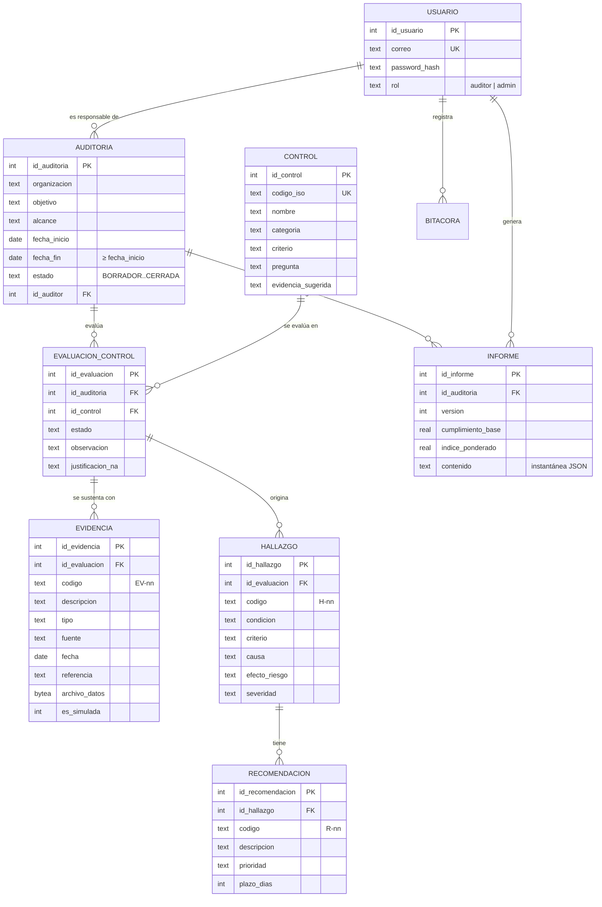
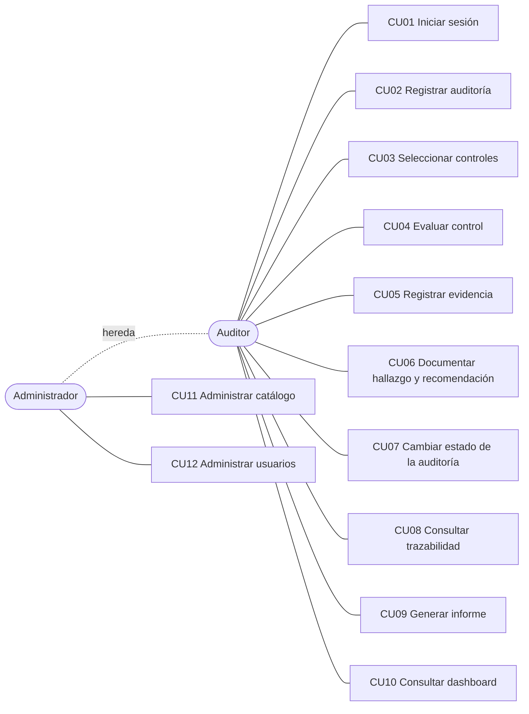
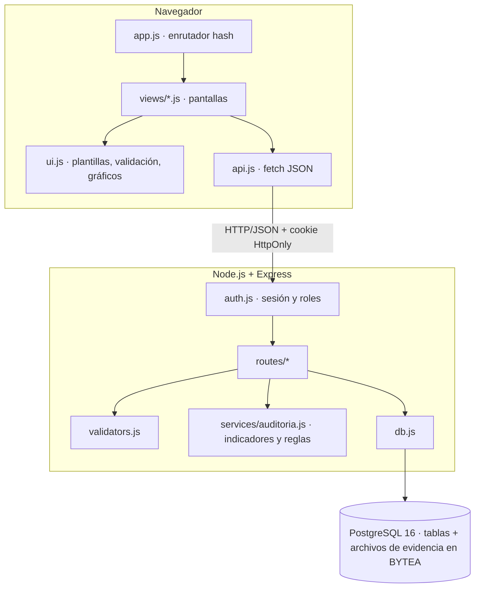
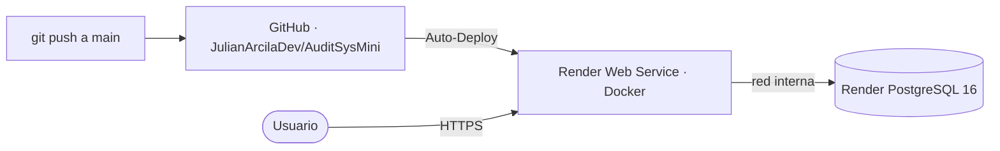

# Modelado de la solución

## 1. Modelo entidad-relación

### Reglas de integridad en la base de datos (`server/schema.sql`, PostgreSQL 16)

| Entidad | Restricciones |
|---|---|
| usuario | correo único; `rol IN ('auditor','admin')` |
| control | `codigo_iso` único; criterio obligatorio; categoría dentro de las 4 de la norma |
| auditoria | `fecha_fin >= fecha_inicio`; estado dentro del ciclo de vida; FK a usuario |
| evaluacion_control | par (auditoría, control) único; observación obligatoria si está evaluado; `NO_APLICABLE` exige justificación |
| evidencia | siempre ligada a una evaluación; exige referencia o archivo; archivo ≤ 5 MB guardado en `BYTEA`; `es_simulada` por defecto 1 |
| hallazgo | condición, criterio, causa, efecto y severidad obligatorios; código único por auditoría |
| recomendacion | siempre ligada a un hallazgo; prioridad y plazo entre 1 y 730 días |
| informe | versión única por auditoría; guarda indicadores e instantánea en `JSONB` |

Las eliminaciones usan `ON DELETE CASCADE` para no dejar registros huérfanos (solo se pueden eliminar auditorías en borrador).

## 2. Casos de uso

| CU | Actor | Flujo principal | Requisitos |
|---|---|---|---|
| CU02 | Auditor | Diligencia organización, objetivo, alcance y fechas → el sistema valida y crea la auditoría en *Borrador* | RF01, RNF03 |
| CU03 | Auditor | Filtra el catálogo y activa entre 10 y 15 controles → guarda la selección | RF02 |
| CU04 | Auditor | Elige un control, lee su criterio, asigna estado y observación (justificación si es N/A) | RF03 |
| CU05 | Auditor | Registra descripción, tipo, fuente, fecha y referencia o archivo | RF04, RNF05 |
| CU06 | Auditor | Selecciona el control, completa condición, criterio, causa, efecto y severidad, y la recomendación con prioridad y plazo | RF05, RF06 |
| CU07 | Auditor | Solicita la transición; el sistema verifica las reglas y la aplica o lista lo pendiente | RNF04 |
| CU09 | Auditor | Elige secciones y genera una versión; imprime o guarda en PDF | RF08 |
| CU10 | Auditor/Admin | Consulta los indicadores globales o de una auditoría | RF07, RF09 |
| CU11 | Admin | Crea, edita o desactiva controles | RF02, RNF04 |

## 3. Componentes

## 4. Despliegue

